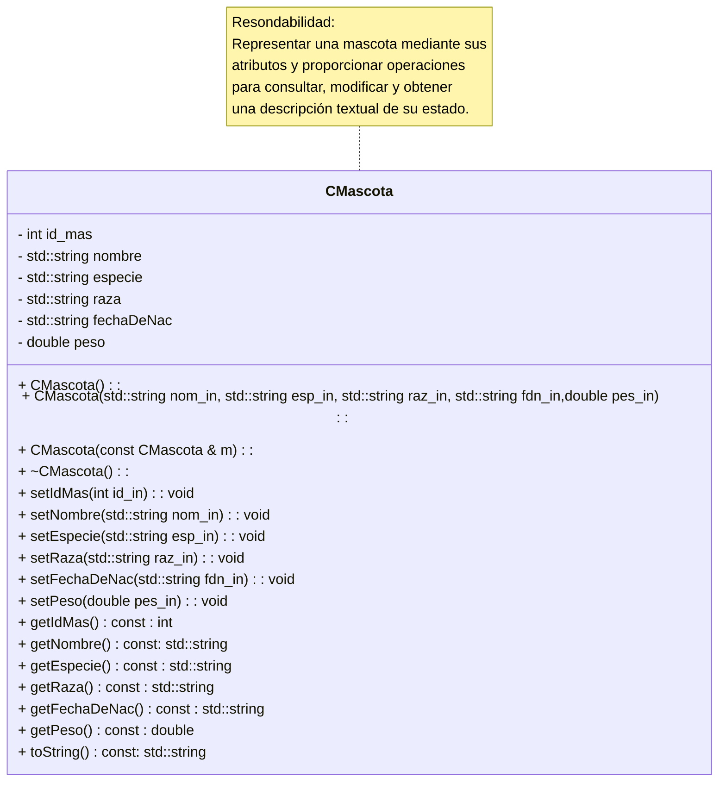

# Actividad 6c - Desarrollo de la Clase CMascota

### Consigna

Desarrolla la clase CMascota que figura en el siguiente diagrama y realiza una pequeña apliación de prueba de la clase

Crea la Carpeta CMASCOTA dentro de la carpeta CLASES. Dentro de la carpeta CMASCOTA escribe el achivo de definción de clase, **CMascota.h** también conocido como archivo de cabecera. Escribe también el archivo donde se definen los métodos de la clase, es decir el archivo **CMascota.cpp**, conocido también como archivo de implementación. Genera el archivo objeto CMascota.o desde el terminal utilizando un comando similar al usado de la clase CRectangulo.

Desarrolla una aplicación que permita comprobar el funcionamiento de la clase `CMascota`. Para ello:

1. Crea un objeto utilizando el constructor predeterminado.

2. Crea otro objeto utilizando el constructor parametrizado.

3. Modifica algunos atributos mediante los métodos setters.

4. Consulta los atributos mediante los métodos getters.

5. Utiliza `toString()` para mostrar los datos de una mascota.

6. Crea una nueva mascota utilizando el constructor de copia.

Al archivo fuente de esta apliación de prueba llámalo **testClaseCMascota.cpp**

### Para reflexionar

¿Cuál es la responsabilidad de la clase `CMascota` y cómo contribuyen sus atributos y métodos a cumplirla?

